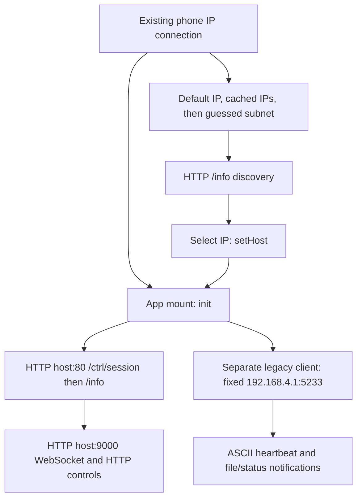

# APK discovery and device communication

The APK's connection setup, discovery, legacy control messages and newer
HTTP/WebSocket protocol are recovered from shipped code. The app uses ordinary
IP networking over the phone's existing connection. Its inspected discovery
path prefers Wi-Fi IPv4 and can fall back to other interfaces, including Ethernet;
it does not perform Ethernet link negotiation or join a Wi-Fi network.

There are two transport families, with different target-selection behavior.
The user's F-Mini11 label and confirmed type-7 BIN playback identify useful media
geometry, but do not prove which network family the phone actually used.

## Finding a target

1. Probe **GET `http://192.168.4.1/info`**, with a two-second timeout. A successful
   JSON response with numeric `code`0 or1 identifies that address as a candidate.
2. If that fails, probe cached IPs from `search-foundDevices`, in groups of10.
3. If those fail, obtain the phone's IPv4 address, guess a `/24` from its first
   three octets and probe hosts `.1` through `.254`, excluding the phone itself.
   The actual interface netmask is not used. Fresh scanning records at most one
   matching host; cached addresses can yield several choices.
4. One result is selected directly; several results produce a selection dialog.
   Selection calls `CONN.setHost(ip)` and `CONN.init()`. Empty search retries
   after seven seconds.

Discovery only checks the response code. It does not validate manufacturer,
model, MAC address or a device name. Native NetworkInfo first reads the Wi-Fi
address; if unavailable or `0.0.0.0`, it enumerates IPv4 interface addresses and
returns the last qualifying one. Thus Ethernet can supply the subnet prefix,
but the app does not explicitly choose a wired interface or route.

There is also a static discovery race: fresh subnet scanning awaits `Promise.any`
on probes whose failures fulfill with `null`. A quick failed probe can finish
the group wait while valid slower probes remain pending. The nominal20-probe
groups are consequently not a strict concurrency limit, and an empty result
can be reported prematurely. This has not been observed on the user's network.

The [discovery report](evidence/android/comms/discovery-findings.md) retains
the exact call chain,52 original Hermes functions and four native REA/JADX method
records establishing the interface behavior.

## Starting communication



**Newer devices:** `setHost` updates the HTTP API target and requests
`GET /ctrl/session`. A numeric `code:0` response leads to `GET /info`, whose
accepted response is copied to `deviceInfo`; its `model` field supplies the model
label. A successful session/info sequence enables `ws://host:9000`.
WebSocket open requests `/ctrl/play?action=status`. A three-second connection
timer sends JSON heartbeats after more than15 seconds since the previous send,
and considers the newer connection lost after20 seconds without a received
heartbeat timestamp.

Admission differs between discovery and the post-session info callback:
discovery accepts numeric0 or1, while the latter rejects numeric1, resets defaults
for it, and otherwise accepts a transport-successful nonempty response when its
code is falsy or not numeric1. No session token/cookie semantics or device-side
authentication behavior have been established from captured traffic.

**Legacy devices:** the DevicePage mount effect calls `CONN.init` independently
of HTTP discovery success; selecting a discovered target also calls it.
The initialization guard prevents repeated setup. `init` separately starts a TCP singleton constructed with
**`192.168.4.1:5233`**. The HTTP `setHost` function does not retarget that socket.
It connects immediately and retries every three seconds. On socket connection
it starts a one-second heartbeat timer and reports connected state. This fixed
address fits direct communication through a display hotspot; the APK does not
establish arbitrary-address Ethernet discovery for that legacy client.

When both paths appear connected, `getIsOldDevice` prioritizes the newer connected
state. Model names are therefore not a reliable substitute for observing which
transport is active.

## Legacy control protocol

Messages are **ASCII bytes**, even though their spelling looks hexadecimal.
The heartbeat is17 bytes, `c31c38abca4a8c2e3`, whose first four wire bytes are
hexadecimal `63 33 31 63`, not `c3 1c`.

| Operation | Exact ASCII message |
| --- | --- |
| Heartbeat/list/status request | `c31c38abca4a8c2e3` |
| Next | `c31c32abca4a8c2e3` |
| Previous | `c31c33abca4a8c2e3` |
| Pause | `c31c34abca4a8c2e3` |
| Resume | `c31c35abca4a8c2e3` |
| Play device index13 | `c31c40abe13a4a8c2e3` |

Delete, loop mode, display on/off, BLE switch and SD formatting encodings are also
retained in the [full control table](evidence/android/comms/legacy-control.md).
They were never sent during this investigation. The send queue converts byte
arrays with `Buffer.from`, calls `socket.write` and resolves locally without
waiting for a device acknowledgment.

The incoming list/status parser accepts ASCII **`c30c38`** at the beginning and
**`a4a8c2e3`** at the end. It starts records at byte9, reads two-digit decimal
lengths and indices, skips three record bytes and decodes names asGBK. Its tail
contains current index, model flag and play state; model flag7 maps toF-MINI11.
Unknown flags, malformed tails and reset state can produce the `F1` label.

This APK passes individual TCP chunks straight to that parser, with no receive
accumulator. The already retained [file-list replay](evidence/android/file-list-replay.json)
demonstrates that split or malformed responses can lose entries. Actual device
notification bytes remain necessary to identify why `13_tractor` and `14_cd`
are absent from the user's app list.

## Newer HTTP and WebSocket protocol

The default HTTP port is80. Filenames are **GBK bytes represented as lowercase
hexadecimal text** for HTTP paths and upload names; `/DCIM` returns names decoded
by the inverse helper. This differs from the legacy parser's raw GBK filenames.

| Operation | Transport and request |
| --- | --- |
| Obtain session / device information | GET `/ctrl/session`, then `/info` |
| Quit session | GET `/ctrl/session?action=quit` |
| Read play status | GET `/ctrl/play?action=status` |
| List files | GET `/DCIM` |
| Play / delete named file | GET `/DCIM/GBK_HEX_FILENAME?act=play` or `?act=rm` |
| Previous / pause | GET `/ctrl/play?action=previous` or `?action=pause` |
| Read settings | GET `/ctrl/get?k=all` or `?k=KEY` |
| Change a setting | GET `/ctrl/set?KEY=VALUE` |
| Format card | GET `/ctrl/card?action=format` |
| Upload via JS HTTP helper | POST `/DCIM/upload`, multipart fields `name` and `file` |
| Maintain connection | WebSocket JSON `{msgId:randomString,cmd:"heartbeat"}` |
| Receive play changes | WebSocket JSON with `cmd:"onPlayInfoUpdate"`; `current` decoded fromGBK hex |

The multipart helper gives `name` the encoded filename and `file` an octet-stream
file part with that same name. Another upload entry calls the native
`MEDIA_FUNC_UPLOAD_V2` boundary with JSON `{url,name,path}` for the same endpoint;
its exact native request construction is outside the recovered JS wire evidence.

The [HTTP command specification](evidence/android/comms/http-commands.json)
records19 request/event operations, payload fields, success criteria and exact
function anchors. Its [raw bytecode](evidence/android/comms/http-bytecode.hasm)
and [offset/hash index](evidence/android/comms/http-index.json) support these
claims. Endpoints beyond those reached by the retained code are not inferred
from naming conventions.

## Legacy native upload protocol

Legacy `TCPClient.uploadFile` calls the Android bridge with JSON `{name,path}`,
not the unused JavaScript upload socket helpers. The native dispatcher converts
the filename toGBK and invokes `NativeCore.oldDevUploadFile(nameBytes,nameLength,
path,progressCallback,resultCallback)`. The APK includes a named native routine
`old_dev_tcp_upload` in `libSPCore.so`. Its detailed recovery and limitations are
recorded in [the native upload report](evidence/android/comms/legacy-upload-findings.md).
The Java/native declaration and the sender body are established separately;
the exact JNI caller/callback wiring has not been fully traced.

Ghidra use-site analysis establishes a separate TCP connection to
**`192.168.4.1:5499`** and this transfer sequence:

1. Compute `blocks=ceil(file_bytes/1440)` and advertise `blocks*1440` bytes.
2. Send a file-info packet containing ASCII `d31d66`, ASCII `DF`, one byte
   `(GBK_filename_byte_count+61)&255`, a **big-endian32-bit padded file size**,
   the rawGBK filename, and ASCII `a4a8c2e3`. For `N` filename bytes the packet
   contains `N+21` bytes. The meaning of the biased byte is not independently
   established; its construction is explicit.
3. Wait for acknowledgment beginning **`d30d66`**.
4. Send **1460-byte** packets: ASCII **`d31d88JMP`** (9bytes),1440 raw file
   bytes, then ASCII **`000a4a8c2e3`** (11bytes). Zero-fill the final payload.
   There is no changing sequence number or calculated checksum in this sender;
   the `000` bytes are constants.
5. Wait for acknowledgment beginning **`d30d88`** after every20 packets and
   after the final packet.
6. Send ASCII completion **`d31d88DEFa4a8c2e3`** (17bytes).

The sender handles partial writes by continuing from the remaining offset.
Missing required data acknowledgments cause failure. Its final completion-send
loop does not check that all17 bytes were written before selecting its success
path. That is a static defect, not proof of what caused the user's earlier
upload failures. The inspected native upload also hardcodes the hotspot IP;
HTTP target selection does not change this destination.

The native ACK helper accumulates TCP fragments in a128-byte buffer, polling
nonblocking receive every5ms and failing after more than5000ms. It accepts at
least14 accumulated bytes when their first six match the expected ACK and their
last eight are ASCII `a4a8c2e3`; middle bytes are unchecked. It does not search
past unexpected leading bytes or discard/resynchronize them, and the sender
does not retransmit failed data blocks. This helper's accumulation is separate
from the control/list parser, which lacks an accumulator.

Unused `_connectUploadSocket`/ACK helper bodies and the declared5499 port alone
do not establish the active transfer framing. Protocol claims must follow the
native routine's use sites. Those use sites, rather than these unused helpers,
establish the transfer described above. Native V2 HTTP upload construction and
device-side acceptance remain separate coverage limits.

## Evidence and reproduction

Target APK SHA256:
`8a83b1f128beb43341eefd2b4ad743512d0193ff6dd4e7b56feba138fb4b63c9`.
Hermes96 bundle SHA256:
`8389750af87d60e75bbd7d93ba57d1bd239008812c8c5ef7ecc84cf2a46777e2`.
Native REA records distinguish static decompilation from execution; Hermes
instruction excerpts have exact original byte offsets and hashes.

```bash
.venv/bin/python tools/extract_android_control_evidence.py
node tools/replay_android_legacy_controls.mjs
.venv/bin/python docs/evidence/android/comms/discovery-extract.py
.venv/bin/python tools/verify_android_comms_evidence.py
```

The control replay captures15 request-construction cases into an in-memory
recorder. It runs selected decompiler state machines with explicit bookkeeping
transformations; it does not execute Hermes bytecode, the socket queue, Android
or firmware. All limitations are retained in
[legacy-control-replay.json](evidence/android/comms/legacy-control-replay.json).
The [communication evidence index](evidence/android/comms/evidence-index.json)
records retained file hashes, exact-range checks and native REA Evidence IDs.

## Live follow-up and implementation

The later authorized ADB tests confirmed this unit uses legacy TCP5233/5499 at
192.168.4.1; HTTP80 and WebSocket9000 were refused. The computer reaches it through
the phone's Wi-Fi using non-PTY `adb shell -T` binary pipes.

The captured reply proves both missing later filenames and false F1 in the
original parser; see [packet findings](evidence/android/live/packet-findings.md).
The new [Python/CLI client](device.md) handles split/coalesced packets, recovers
bounded later entries while reporting incomplete lists, and anchors model status
to the final field. Exact [control-path tracing](evidence/android/live/control-path-findings.md)
found no additional handshake or wire encoding. Commands need separation from
following heartbeats on the tested firmware, and matching states are polled.

The original native upload was executed in a separate on-phone analysis harness.
All249 packets for cd.bin matched the Python construction. Before formatting,
the native sender returned success despite later `0000` ACK fields and loss of
the scratch filename from the directory. Following the user's explicit format
request, the directory became empty and well formed and transfers returned
`ffff` throughout. The precise ACK middle-field meanings and original directory
corruption cause remain unknown. Retained captures, methods, conditions and
limitations are in [live device findings](evidence/android/live/device-findings.md).
